# ShelfWise — a library lending desk, from laptop to a monitored Kubernetes cluster

**Shubham Kumar** · Enrollment **24BCS10320** · DevOps Heros — Session 21 final capstone

ShelfWise is the lending desk of a campus library. Librarians catalogue books and
their physical copies, register students and faculty, lend and take back copies,
collect fines and run the holds queue for popular titles. The rules a real desk
needs are built in — a copy can never be lent twice, loan limits depend on the
member, late returns are fined and unpaid fines block borrowing, and a returned
copy goes to the first member waiting for it — and every refusal comes back as a
clear sentence, not a crash.

Around the app sits the whole DevOps path from the course: Git, tests, Docker,
GitHub Actions with security gates, GHCR, Terraform on AWS (VPC + EKS), Kubernetes
with Helm, GitOps with Argo CD, and Prometheus + Grafana.

| | |
|---|---|
| 🎥 **Demo video** | [`demo/ShelfWise-demo.mp4`](demo/ShelfWise-demo.mp4) (12 min, captioned) |
| 📊 **Slides** | [`demo/ShelfWise-presentation.pdf`](demo/ShelfWise-presentation.pdf) · [`.pptx`](demo/ShelfWise-presentation.pptx) |
| ✅ **Green pipeline run** | [run #10 — ui: show the library branch on the dashboard](https://github.com/shubhamkumar9199/devops-heros/actions/runs/38908055488) |
| 📦 **Images (GHCR)** | [shelfwise-backend](https://github.com/users/shubhamkumar9199/packages/container/package/shelfwise-backend) · [shelfwise-frontend](https://github.com/users/shubhamkumar9199/packages/container/package/shelfwise-frontend) |

| Layer | What | Where |
|---|---|---|
| Frontend | React 19 + Vite 8, served by unprivileged nginx | [`frontend/`](frontend/) |
| Backend | FastAPI 0.143, SQLAlchemy 2.1, Alembic 1.20, PostgreSQL 17 | [`backend/`](backend/) |
| Tests | 74 pytest tests, 93 % coverage, real races on PostgreSQL | [`backend/tests/`](backend/tests/) |
| Containers | multi-stage, non-root, digest-pinned; one-command compose | [`docker-compose.yml`](docker-compose.yml) |
| CI/CD | 10 jobs on every push to `main`, images tagged with the commit SHA | [`../.github/workflows/shelfwise-ci-cd.yml`](../.github/workflows/shelfwise-ci-cd.yml) |
| Security | Trivy (images + IaC), Gitleaks, Bandit, pip-audit, npm audit, Pod Security `restricted` | [`security/`](security/) |
| Infrastructure | Terraform: VPC over 2 AZs + EKS 1.35 + managed node group, `ap-south-1` | [`terraform/`](terraform/) |
| Kubernetes | Helm chart: 2+ replicas, ClusterIP Services, Traefik Ingress, HPA, PDB, NetworkPolicy | [`helm/shelfwise/`](helm/shelfwise/) |
| GitOps | Argo CD syncs the chart from Git; CI only commits new image tags | [`gitops/`](gitops/) |
| Observability | `/metrics`, ServiceMonitor, alert rules, a 14-panel Grafana dashboard | [`monitoring/`](monitoring/) |

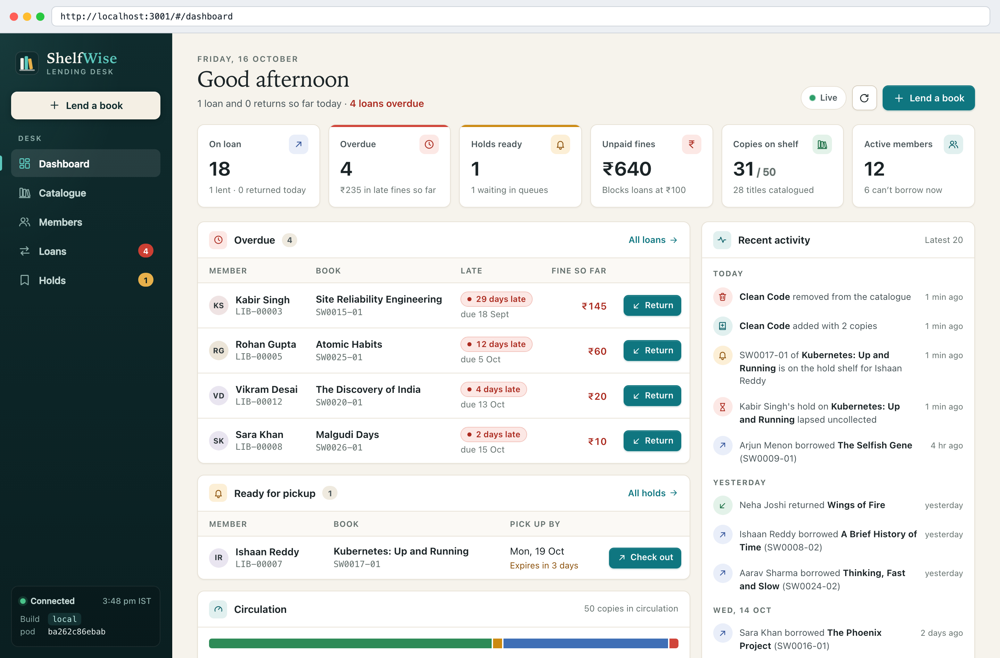

## Contents

1. [What the app does](#1-what-the-app-does)
2. [Architecture](#2-architecture)
3. [Tech stack](#3-tech-stack)
4. [Repository layout](#4-repository-layout)
5. [Run it locally](#5-run-it-locally)
6. [M1 — Application](#m1--application)
7. [M2 — Testing](#m2--testing)
8. [M3 — Git and GitHub](#m3--git-and-github)
9. [M4 — Docker](#m4--docker)
10. [M5 — CI/CD](#m5--cicd)
11. [M6 — DevSecOps](#m6--devsecops)
12. [M7 — Terraform on AWS](#m7--terraform-on-aws)
13. [M8 — Kubernetes, Helm and GitOps](#m8--kubernetes-helm-and-gitops)
14. [M9 — Observability](#m9--observability)
15. [Troubleshooting labs](#troubleshooting-labs)
16. [Engineering findings](#engineering-findings)
17. [Known issues and limitations](#known-issues-and-limitations)
18. [M10 — Presentation](#m10--presentation)
19. [Submission checklist](#submission-checklist)

---

## 1. What the app does

| Rule | How it is enforced |
|---|---|
| A copy is never lent twice | `borrow()` locks the member and the book rows before it checks anything; a partial unique index (`one active loan per copy`) backs it up in PostgreSQL |
| Loan limits | students 3 books for 14 days, faculty 6 for 28 days; a faculty member can't be downgraded below their current loans |
| Renewals | at most 2, never once overdue, never while another member is waiting |
| Fines | ₹5 per day (or part of a day) late, capped at ₹200 per loan; ₹500 for a lost copy |
| Blocking | an overdue book, or ₹100 or more unpaid, stops new loans, renewals and holds |
| Holds queue | only for titles with no copy on the shelf; a returned (or newly added) copy goes to the first member waiting, who has 3 days to collect it, then it passes on |
| History is kept | books with lending history can't be deleted (withdraw copies instead); closing a membership needs no books out and no fines |

The rules are published at `GET /api/info`, so the UI never hardcodes them. Every
change also lands in an `activity` table that the dashboard shows as a feed.

| Method | Path | What |
|---|---|---|
| GET | `/health` | liveness — answers without touching the database |
| GET | `/ready` | readiness — the database answers and the newest table exists (else `503`) |
| GET | `/metrics` | Prometheus: HTTP metrics + business gauges |
| GET | `/api/info` | build SHA, pod name, lending rules |
| GET / POST | `/api/books` | search (`q`, `genre`, `available`) / add a book with N copies (ISBN-10 or -13, check digit validated) |
| GET / PUT / DELETE | `/api/books/{id}` | details with copies and queue / replace / delete (409 if it has history) |
| POST · PUT · DELETE | `/api/books/{id}/copies` · `/api/copies/{id}` | add, edit, withdraw a copy |
| GET / POST | `/api/members` | list / register |
| GET / PUT / DELETE | `/api/members/{id}` | details with loans and holds / edit / close membership |
| GET / POST | `/api/loans` | filter (`active`, `overdue`, `unpaid`, `returned`, `lost`) / lend |
| POST | `/api/loans/{id}/return` · `/renew` · `/lost` · `/pay` | the loan state machine |
| GET / POST | `/api/holds` | open holds with queue positions / join the queue |
| DELETE | `/api/holds/{id}` | leave the queue (a ready copy passes to the next member) |
| POST | `/api/holds/expire` | lapse uncollected holds (the CronJob runs the same code) |
| GET | `/api/stats` · `/api/activity` | dashboard numbers and the activity feed |

Swagger UI: `/api/docs`. Refusals are `409 {"detail": "<sentence>", "code": "<rule>"}`.

## 2. Architecture

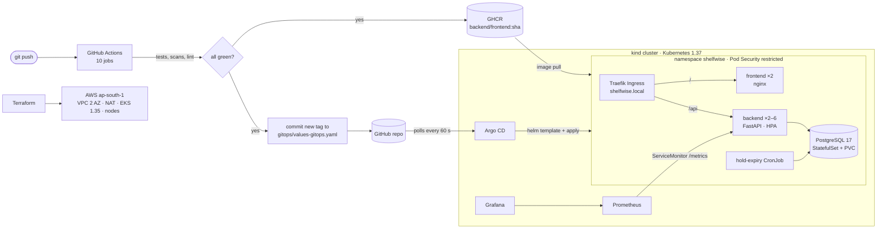

The CI pipeline never touches a cluster. It pushes images and commits the new tag
to Git; Argo CD notices the commit and rolls it out (GitOps). Terraform builds the
AWS side separately; the same Helm chart has a `values-prod.yaml` for EKS.

## 3. Tech stack

| Area | Tools (versions as used) |
|---|---|
| Frontend | React 19.3, Vite 8.3, plain CSS, no UI framework |
| Backend | Python 3.12, FastAPI 0.143, Starlette 1.8, SQLAlchemy 2.1, Alembic 1.20, psycopg 3.3, Pydantic 2.14, uvicorn 0.54 |
| Database | PostgreSQL 17.11 |
| Testing | pytest 9.1, pytest-cov 7.1, httpx2 (Starlette 1.x TestClient), ruff 0.17 |
| Containers | Docker, `python:3.12.15-slim-trixie`, `node:24.22-alpine3.24`, `nginx-unprivileged:1.31.7-alpine3.24` (all pinned by digest) |
| CI/CD | GitHub Actions (actions pinned to commit SHAs), GHCR |
| Security | Trivy 0.76, Gitleaks 8.30, Bandit 1.9, pip-audit, npm audit, kubeconform, actionlint |
| IaC | Terraform 1.15, AWS provider 6.69 |
| Kubernetes | kind 0.33 (Kubernetes 1.37), Helm 4.3, Traefik 3.7 (chart 41.7.1), metrics-server 0.9 |
| GitOps | Argo CD 3.5 (chart 10.10.5) |
| Observability | kube-prometheus-stack 92.8 (Prometheus Operator 0.94, Grafana 13.2, Alertmanager), prometheus-fastapi-instrumentator 8.1 |

## 4. Repository layout

```text
session21-python/
├── backend/              FastAPI app (app/), Alembic migrations, tests/, Dockerfile
├── frontend/             React app (src/), nginx template, Dockerfile
├── docker-compose.yml    postgres → backend → frontend, in health order
├── helm/shelfwise/       the Helm chart + values-{dev,staging,prod}.yaml + Grafana dashboard JSON
├── k8s/                  namespaces (Pod Security restricted), kind config, Traefik values
├── gitops/               Argo CD values, the Application, values-gitops.yaml (written by CI)
├── monitoring/           kube-prometheus-stack and metrics-server values
├── terraform/            VPC + EKS (plain resources), tfvars example, accepted IaC findings
├── security/             Trivy, Gitleaks and Bandit configuration
├── scripts/              cluster-up / down, deploy-staging, seed, load-test
├── troubleshooting/      four broken workloads + how each was diagnosed and fixed
├── docs/evidence/        raw output of every command behind the screenshots
├── screenshots/          the evidence images used below
├── demo/                 the video and the slides
├── task/, taskboard/     earlier Session 21 homework (StudySprint reference app) — not part of the capstone
└── README.md
```

The pipeline lives at the repository root, as GitHub requires:
[`.github/workflows/shelfwise-ci-cd.yml`](../.github/workflows/shelfwise-ci-cd.yml).

## 5. Run it locally

```bash
cd session21-python
docker compose up --build        # → http://localhost:3000   API docs: http://localhost:8000/api/docs
docker compose exec backend python -m app.seed   # optional: 60 days of lending history
docker compose down -v           # stop and delete the database volume
```

Copy `.env.example` to `.env` to set your own database password. If port 3000 is
busy, `FRONTEND_PORT=3001 docker compose up --build` (on my Mac a VS Code extension
holds `127.0.0.1:3000`, so the screenshots below use 3001).

Without Docker: `cd backend && uv venv -p 3.12 .venv && uv pip install -r requirements-dev.txt`,
then `python -m pytest`; the frontend runs with `npm ci && VITE_API_TARGET=http://localhost:8000 npm run dev`.

The whole cluster platform is one script: `scripts/cluster-up.sh` (kind, metrics-server,
Traefik, Prometheus/Grafana, Argo CD, namespaces, database Secrets, the Argo CD Application).

---

## M1 — Application

FastAPI backend with 30+ routes over GET/POST/PUT/DELETE, PostgreSQL with three
Alembic migrations, and a React UI calling `/api` on the same origin.

| Dashboard | Book with its copies, hold shelf and queue |
|---|---|
|  | 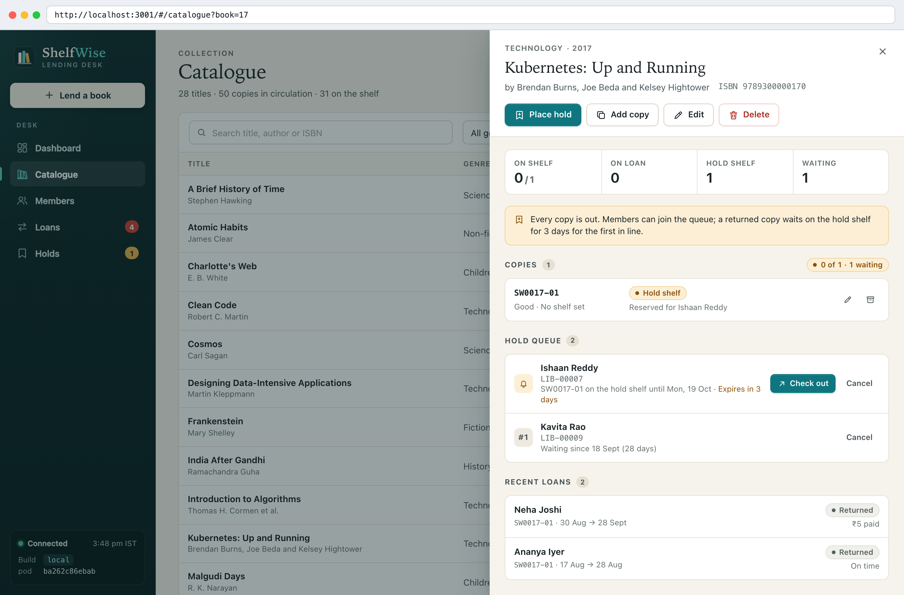 |
| **A rule refusal, shown with the server's own sentence** | **A member blocked by unpaid fines** |
| 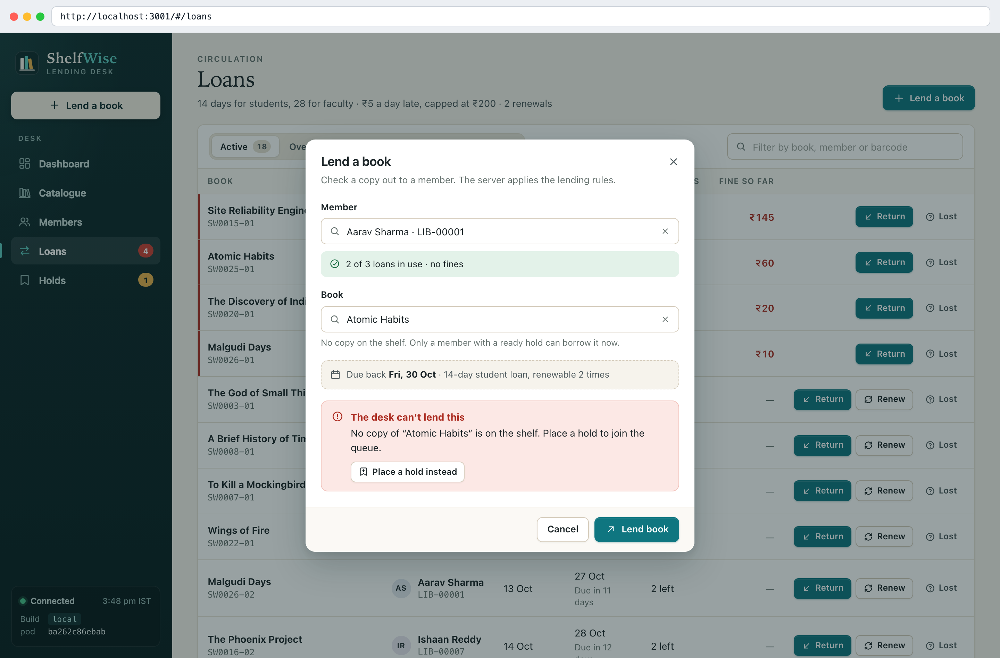 | 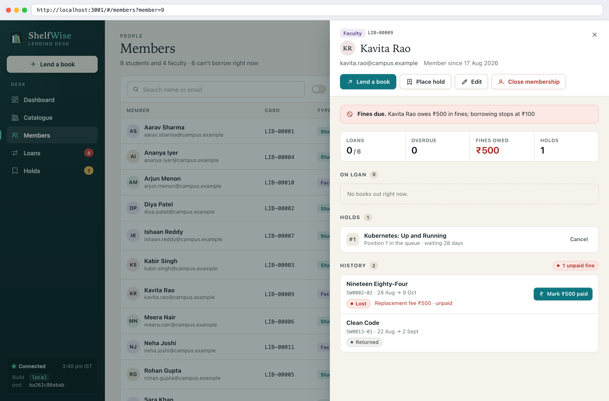 |
| **Overdue loans with fines so far** | **Holds: ready shelf first, then the queue** |
| 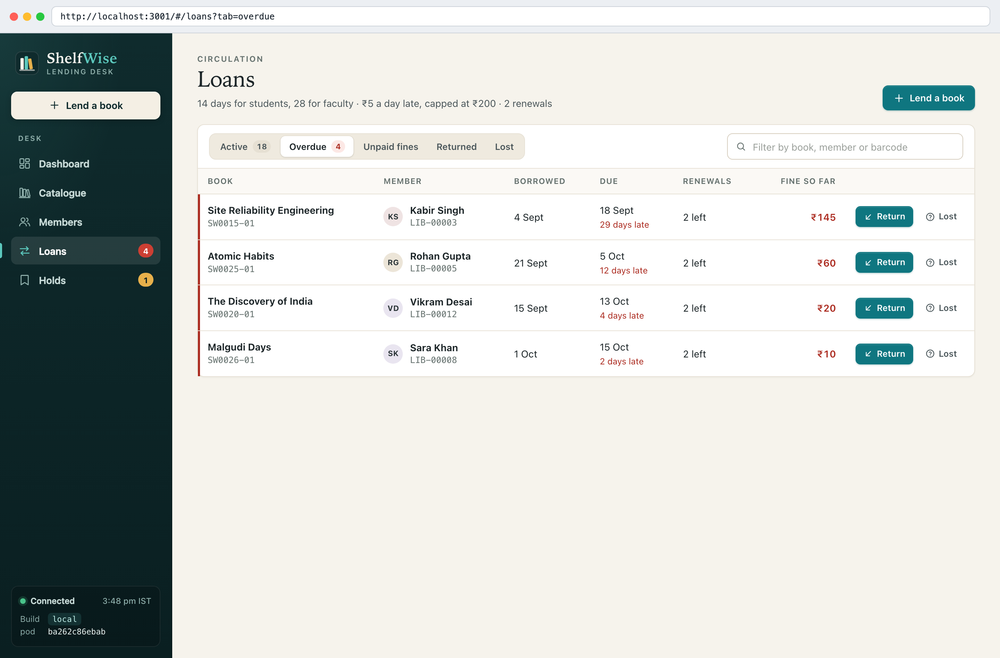 | 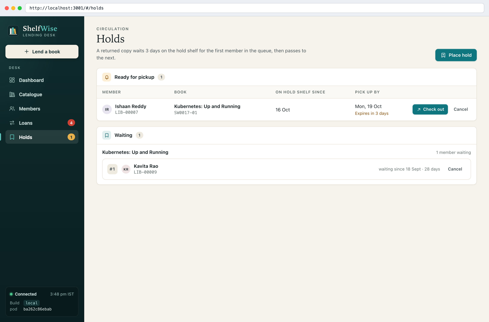 |

Responsive: at phone width the sidebar becomes a top bar plus a bottom tab bar and tables become cards.

| Phone (390 px) | | Swagger UI |
|---|---|---|
| 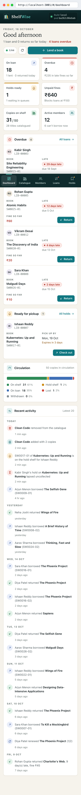 | 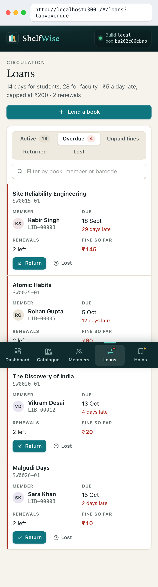 | 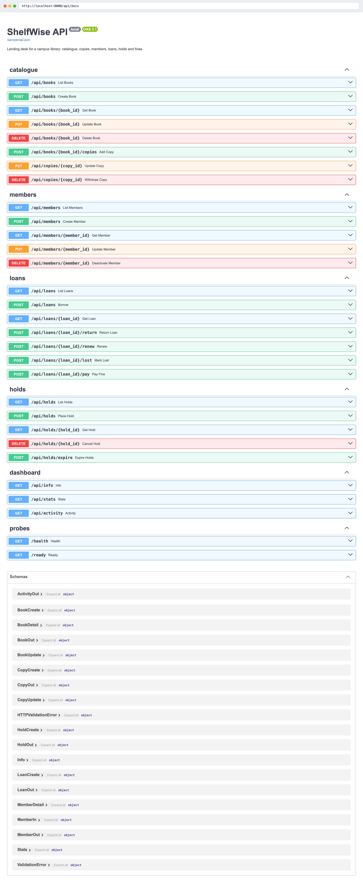 |

Migrations: [`0001_catalogue`](backend/alembic/versions/0001_catalogue.py),
[`0002_members_loans`](backend/alembic/versions/0002_members_loans.py),
[`0003_holds_activity`](backend/alembic/versions/0003_holds_activity.py) — with CHECK
constraints and partial unique indexes, so the database refuses bad rows too.

## M2 — Testing

74 tests in [`backend/tests/`](backend/tests/) cover every endpoint, every rule
and every loan/hold state transition (happy paths, 404, 409, 422), the metrics output,
the migrations (upgrade → downgrade → upgrade) and a 60-day simulated library whose
invariants are checked afterwards.

- **Never the real database.** [`conftest.py`](backend/tests/conftest.py) points
  `DATABASE_URL` at a throwaway SQLite file *before* the app is imported, and builds
  the schema by running the real Alembic migrations. In CI the same suite also runs
  against a disposable PostgreSQL service container (`TEST_DATABASE_URL`).
- **Time is controlled**: a frozen clock fixture moves days forward for due dates, fines and hold expiry.
- **Real races**: two tests start several *processes* at the same instant against
  PostgreSQL — ten members for the last copy (exactly one wins, nine get
  `no_copy_available`), one student at six desks (exactly three loans).
- [`pytest.ini`](backend/pytest.ini) sets strict markers and config; ruff lints and checks formatting.

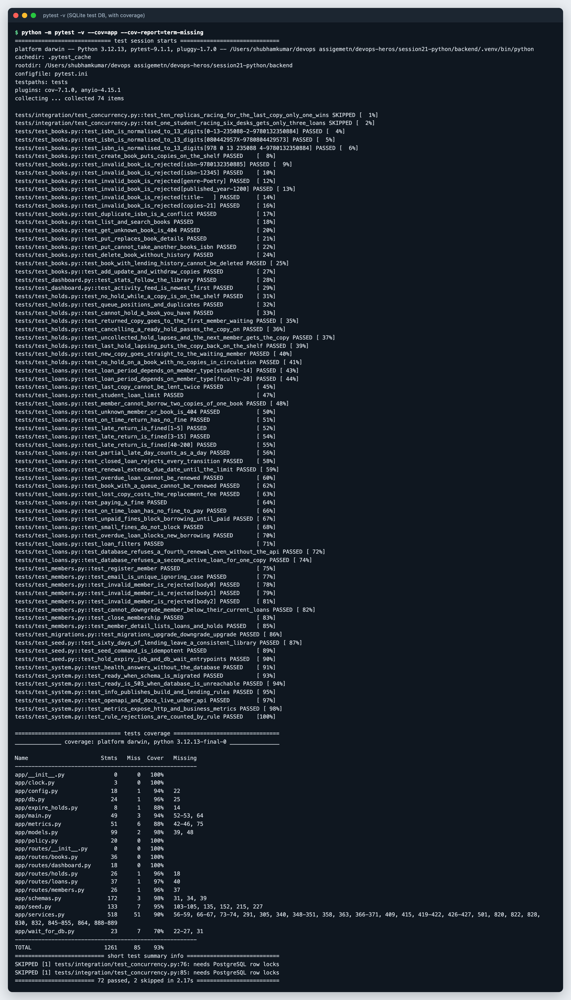

Raw output: [`docs/evidence/m2-pytest.txt`](docs/evidence/m2-pytest.txt) (SQLite, with coverage) ·
[`docs/evidence/m2-pytest-postgres.txt`](docs/evidence/m2-pytest-postgres.txt) (PostgreSQL).

## M3 — Git and GitHub

Public repository, one commit per step with a message that says what and why
(no "update"/"fix"); the [`.gitignore`](.gitignore) (plus the repository root one)
excludes `.env`, `__pycache__`, `node_modules`, `.venv`, Terraform state and real `tfvars`.

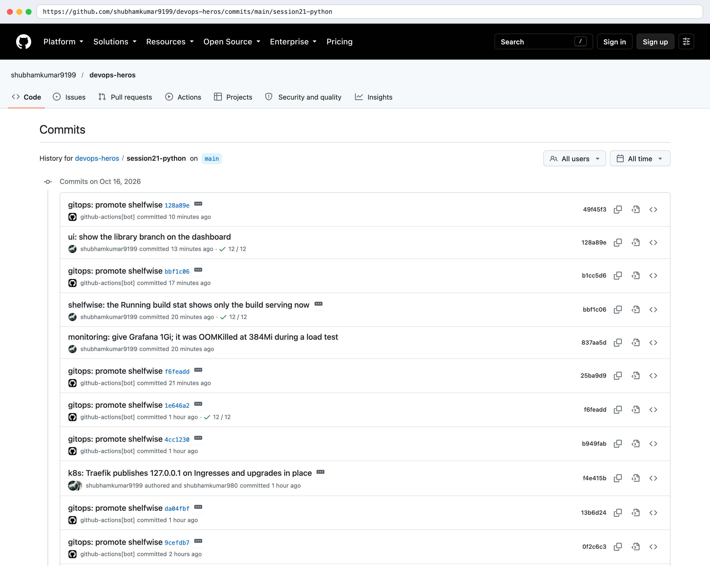

## M4 — Docker

| Image | Build | Runs as |
|---|---|---|
| [`backend/Dockerfile`](backend/Dockerfile) | multi-stage: dependencies in a venv, pip removed from the runtime, base pinned by digest | UID 10001 |
| [`frontend/Dockerfile`](frontend/Dockerfile) | multi-stage: Node 24 builds `dist/` → unprivileged nginx serves it; unused nginx modules removed (71 → 31 packages) | UID 101 |

[`docker-compose.yml`](docker-compose.yml) starts `postgres` → `backend` → `frontend`
in health order (`pg_isready`, then `/ready`), with read-only root filesystems, all
Linux capabilities dropped and `no-new-privileges`.

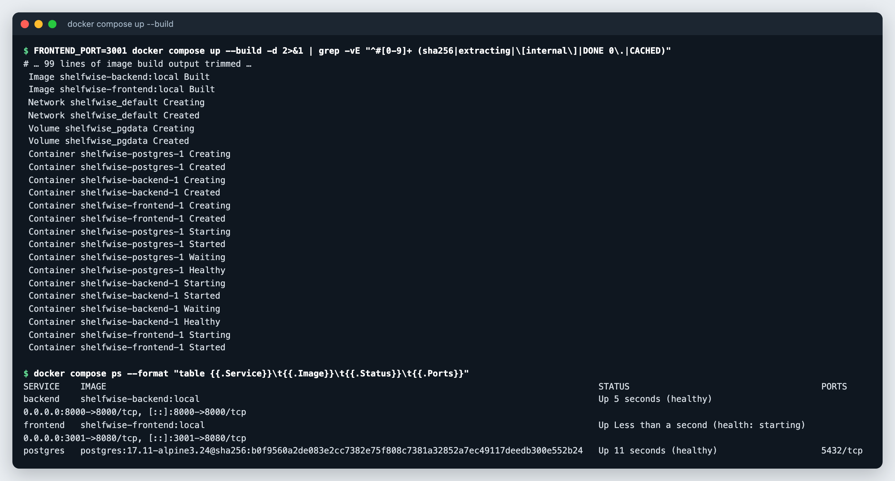

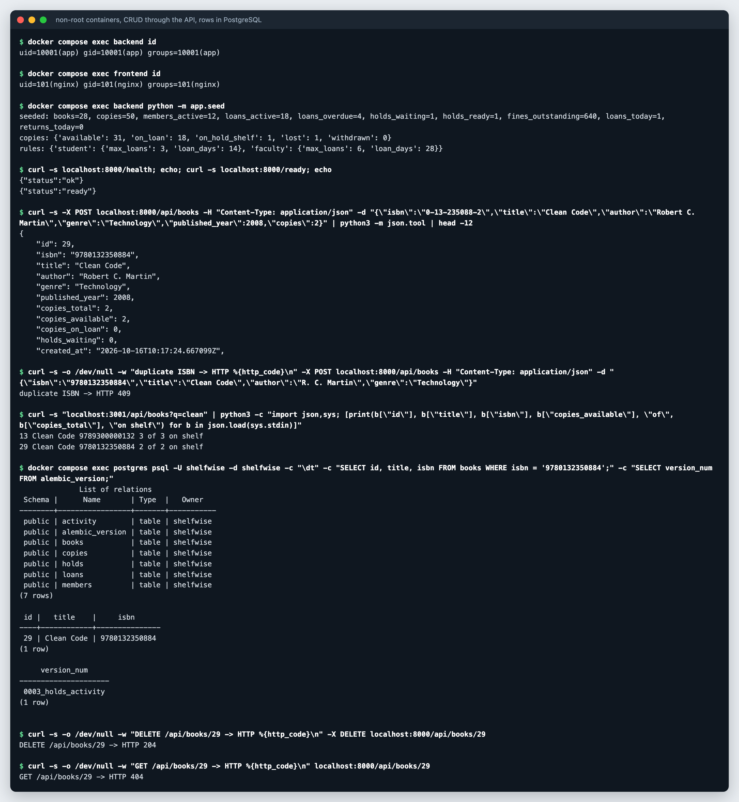

Raw output: [`m4-compose-up.txt`](docs/evidence/m4-compose-up.txt) · [`m4-runtime.txt`](docs/evidence/m4-runtime.txt).

## M5 — CI/CD

[`.github/workflows/shelfwise-ci-cd.yml`](../.github/workflows/shelfwise-ci-cd.yml) runs
on every push to `main` that touches the capstone:

| Job | What it proves |
|---|---|
| Backend tests | `ruff check`, `ruff format --check`, `pytest -v --cov` — any failure stops everything |
| PostgreSQL integration | migrations up/down/up; **three replicas migrating at once** (exactly one runs them, the advisory lock makes the rest wait); the full suite incl. the races on real PostgreSQL |
| Frontend build | `npm ci`, `npm audit --omit=dev --audit-level=high`, `npm run build` |
| Security | Gitleaks over the capstone's whole history, Bandit, pip-audit |
| Helm | `helm lint` + `kubeconform` (Kubernetes 1.36 + CRD schemas) for dev/staging/prod; the chart must refuse to render without a SHA |
| Terraform | `fmt -check`, `validate`, Trivy misconfiguration scan |
| Build + Trivy (×2) | `docker build`, Trivy gate, `docker save` → artifact |
| Push (×2) | `docker load` the **scanned** tarball → push `ghcr.io/shubhamkumar9199/shelfwise-{backend,frontend}:<full SHA>` |
| Deploy (kind) | Pod Security restricted namespace, `helm upgrade --install --wait` from GHCR, `helm test`, smoke test (`/api/info` reports this SHA, create → 201, duplicate → 409) |
| Promote | commits the SHA into `gitops/values-gitops.yaml` as `github-actions[bot]` — Argo CD deploys it |

Choices that matter: `permissions: contents: read` by default (write only where
needed); every third-party action pinned to a commit SHA; the promote commit is
path-ignored so it can't re-trigger the pipeline; tags are the full commit SHA,
never `latest`.

Green run: **[run #10 — ui: show the library branch on the dashboard](https://github.com/shubhamkumar9199/devops-heros/actions/runs/38908055488)** (3 min 35 s, started by the live-demo push in the video).

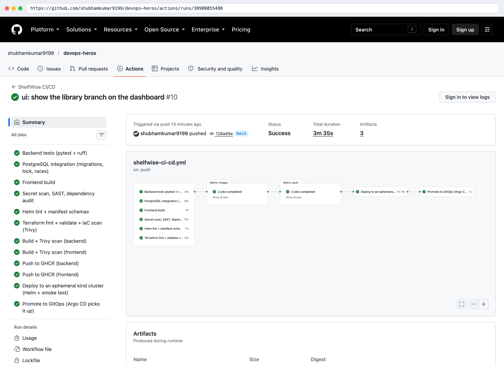

| GHCR backend versions | GHCR frontend versions |
|---|---|
| 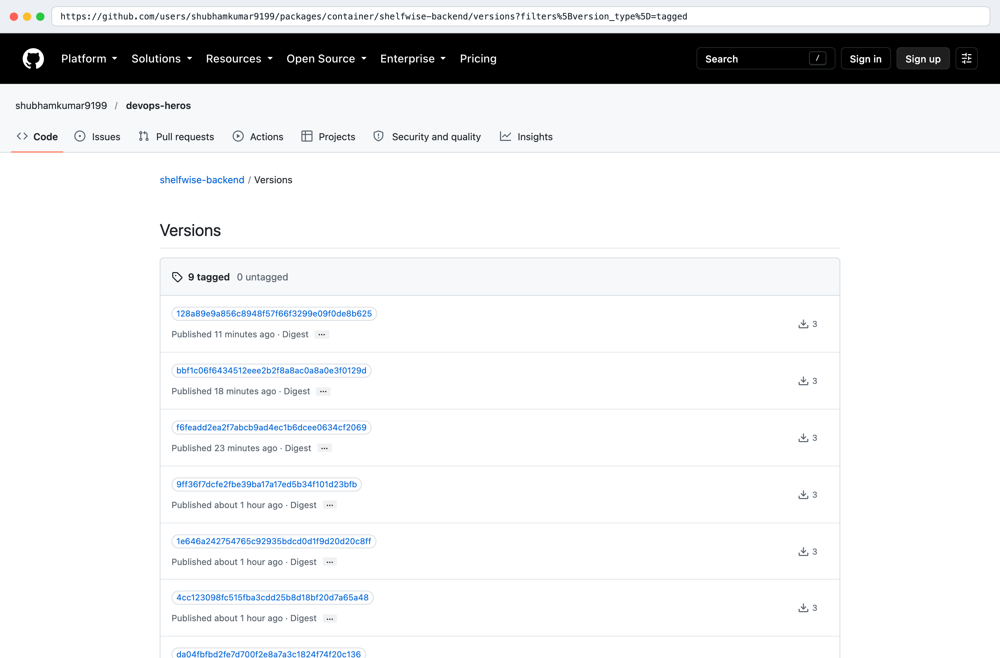 | 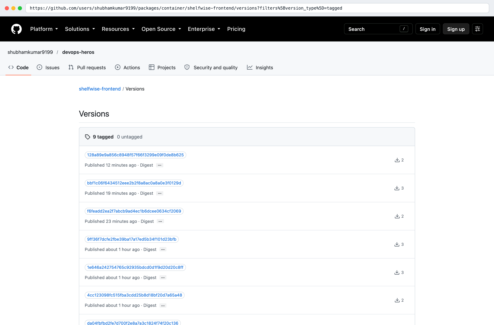 |

Two of the early runs failed for real reasons, and each was fixed in its own commit: Bandit
flagged string-built SQL in the seed script, and `helm test --logs` lost its pod (see
[Engineering findings](#engineering-findings)).

## M6 — DevSecOps

Trivy runs in CI on **both** images with [`security/trivy.yaml`](security/trivy.yaml):
it fails the build on any HIGH or CRITICAL vulnerability that has a fix available,
and on any HIGH or CRITICAL secret finding (private keys, cloud and GitHub tokens, …) baked into a layer.

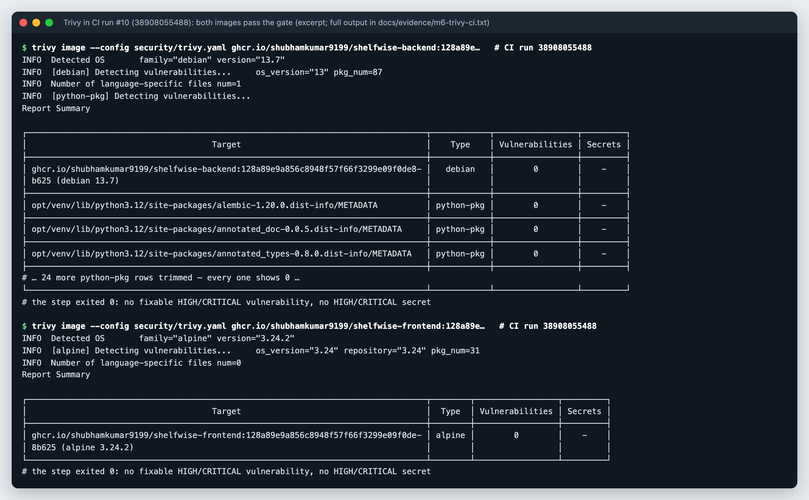

**What the scan says.** In run #10 both images pass. The backend (Debian 13.7: 87 OS packages and 27 Python packages) and the frontend (Alpine 3.24.2: 31 packages) have no HIGH or CRITICAL vulnerability with a fix available and no HIGH or CRITICAL secret, so the step exits 0. Full step output: [`docs/evidence/m6-trivy-ci.txt`](docs/evidence/m6-trivy-ci.txt).

**One CVE, explained.** Scanned without `--ignore-unfixed` ([`docs/evidence/m6-trivy-unfixed.txt`](docs/evidence/m6-trivy-unfixed.txt)), the backend's Debian 13 base reports 8 distinct HIGH CVEs (44 findings across packages, 0 CRITICAL) for which Debian has not released a fixed package yet; the gate lets exactly these through, on purpose. Take **CVE-2025-69720** (CVSS 7.8): a stack-based buffer overflow in ncurses' `infocmp` tool (`analyze_string` in `progs/infocmp.c`). It is fixed upstream in ncurses 6.5-20251213, but Debian 13's `6.5+20250216-2` is still marked *affected*, so no rebuild can remove it. Exploiting it needs a local user to run `infocmp` on a crafted terminfo entry; the API never runs it, and the container runs as UID 10001 with a read-only root filesystem and all capabilities dropped. Failing the build would block every release without making anything safer, so the plan is: keep the base image pinned by digest, bump it when Debian ships the fix, and let CI rescan every build.

The other gates: Gitleaks (whole history), Bandit (SAST), pip-audit and npm audit
(dependencies), Trivy IaC on Terraform (three accepted findings, each justified in
[`terraform/.trivyignore.yaml`](terraform/.trivyignore.yaml)), Pod Security
`restricted` on every namespace, and a pinned supply chain (actions by commit SHA —
the Trivy GitHub Action's own tags were hijacked in March 2026, GHSA-69fq-xp46-6x23 —
and base images by digest).

## M7 — Terraform on AWS

[`terraform/`](terraform/) uses plain resources so every object is visible:
VPC `10.20.0.0/16` with DNS hostnames, **two public and two private subnets** in
`ap-south-1a/b` (tagged for load balancers), internet gateway, one NAT gateway with an
Elastic IP, route tables, IAM roles for the cluster, the nodes and the EBS CSI driver,
an **EKS 1.35 cluster** (API authentication mode, audit logs, standard support only)
with a **managed AL2023 node group** (2 × t3.medium in the private subnets), and the
EKS Pod Identity agent + EBS CSI add-ons. Credentials come from an AWS CLI profile —
nothing is committed; [`terraform.tfvars.example`](terraform/terraform.tfvars.example)
documents the inputs.

```bash
cd terraform
cp terraform.tfvars.example terraform.tfvars      # set api_allowed_cidrs to your IP /32
AWS_PROFILE=<profile> terraform init
AWS_PROFILE=<profile> terraform plan -out=tfplan
AWS_PROFILE=<profile> terraform apply tfplan
aws eks update-kubeconfig --region ap-south-1 --name shelfwise-eks
AWS_PROFILE=<profile> terraform destroy
```

**The real run (16 October 2026).** `terraform plan` showed 28 resources to add; `terraform apply` finished in 12 min 23 s. `kubectl get nodes` showed both AL2023 nodes Ready in the private subnets. The same Helm chart was installed on EKS with `values-prod.yaml` (3 backend + 3 frontend pods, PostgreSQL on a 1 GiB EBS volume) and `helm test` passed. The AWS Console showed the VPC, its four subnets, the NAT gateway, the cluster and the node group. Then the release and its volume were removed, and `terraform destroy` deleted all 28 resources in 20 min 2 s; a final check found no ShelfWise cluster, VPC, Elastic IP, instance, volume or log group left. From apply to destroy took 1 h 37 min, which by on-demand prices (EKS $0.10/h, one NAT gateway, 2 × t3.medium) is well under $1.

| `terraform plan` | `terraform apply` |
|---|---|
| 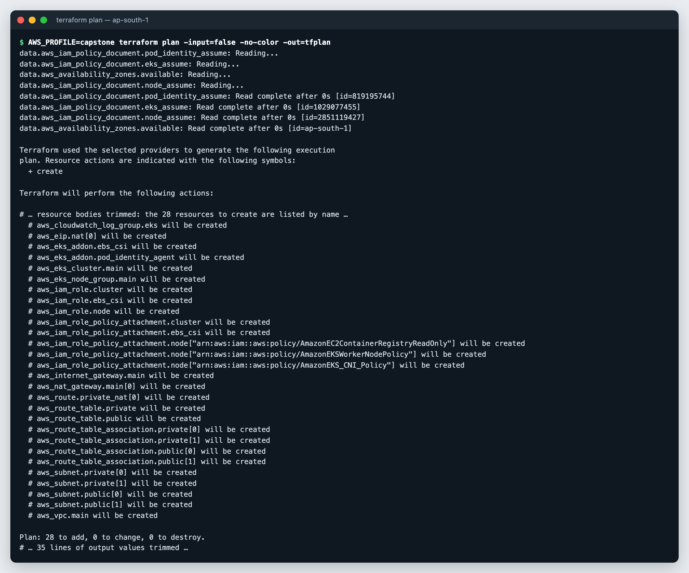 | 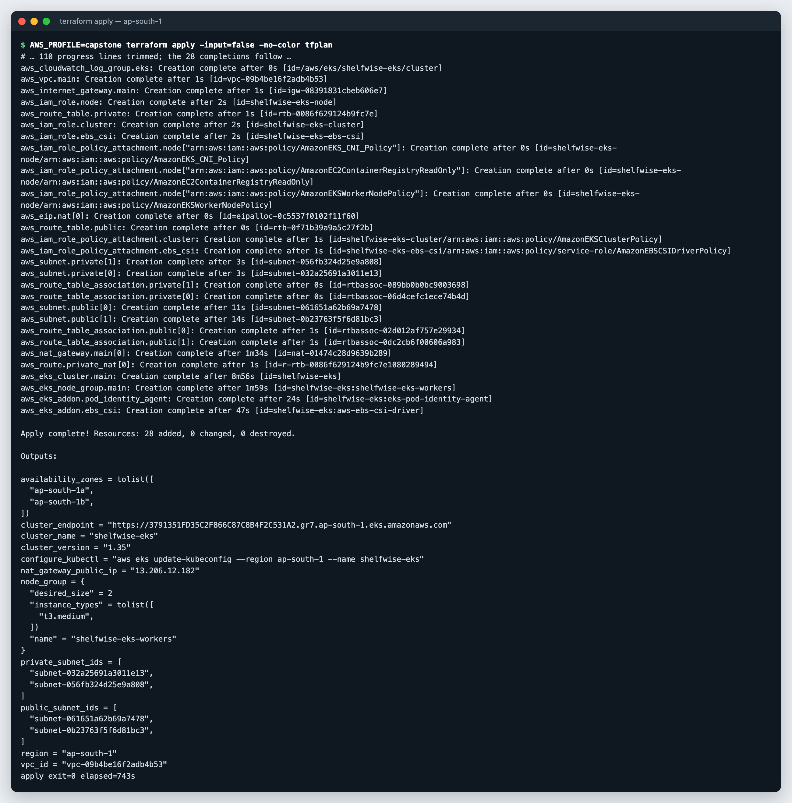 |
| **AWS Console: the VPC** | **AWS Console: four subnets over two AZs** |
| 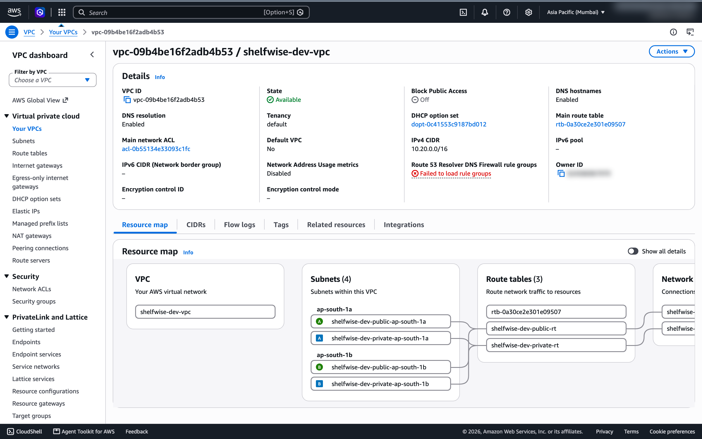 | 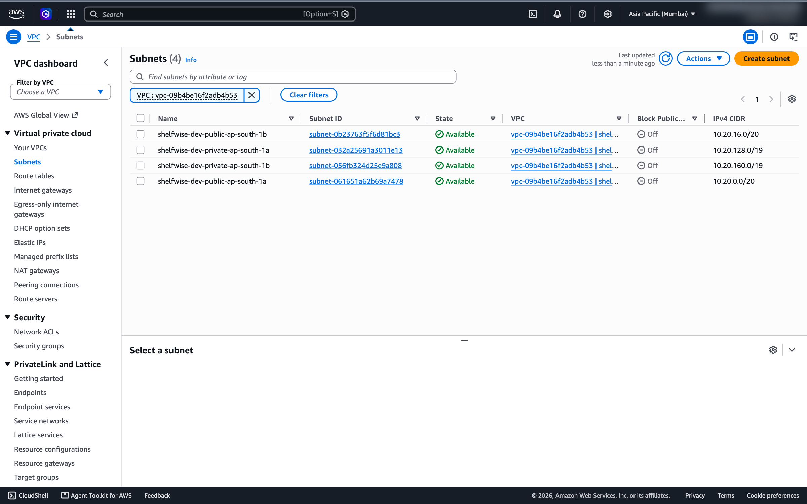 |
| **AWS Console: the NAT gateway** | **AWS Console: the EKS cluster** |
| 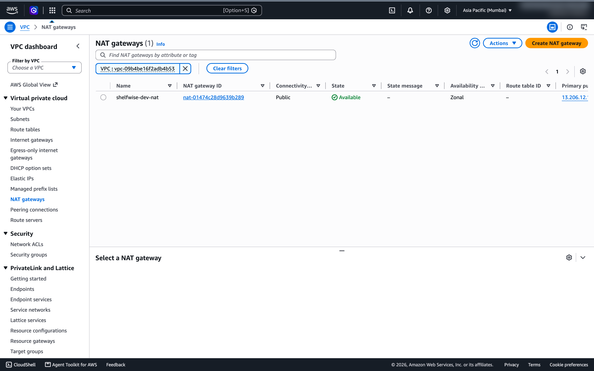 | 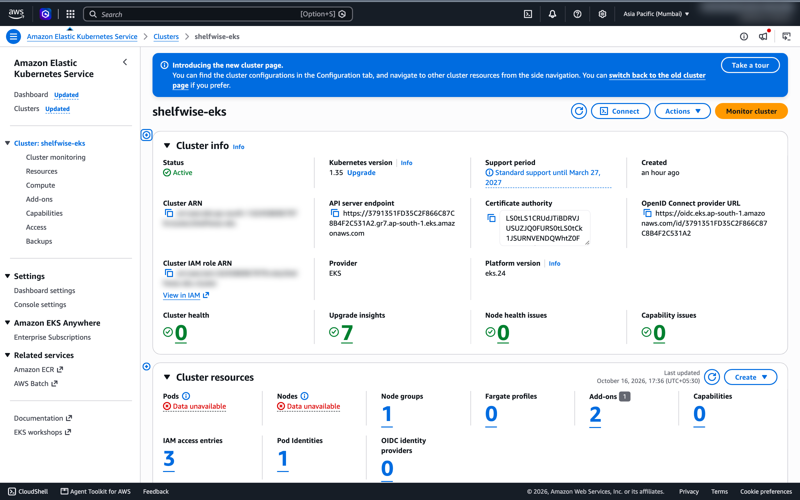 |
| **EKS node group (Compute)** | **kubectl against EKS** |
| 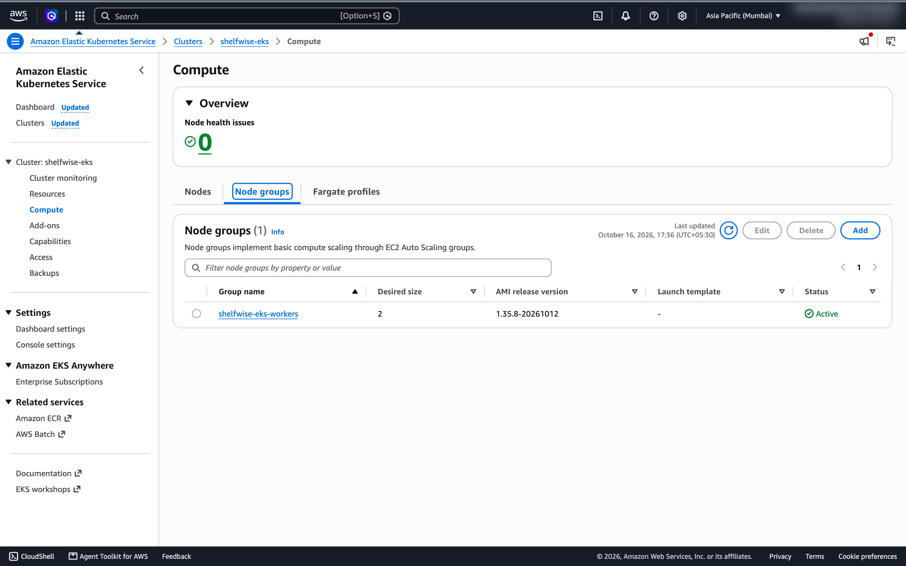 | 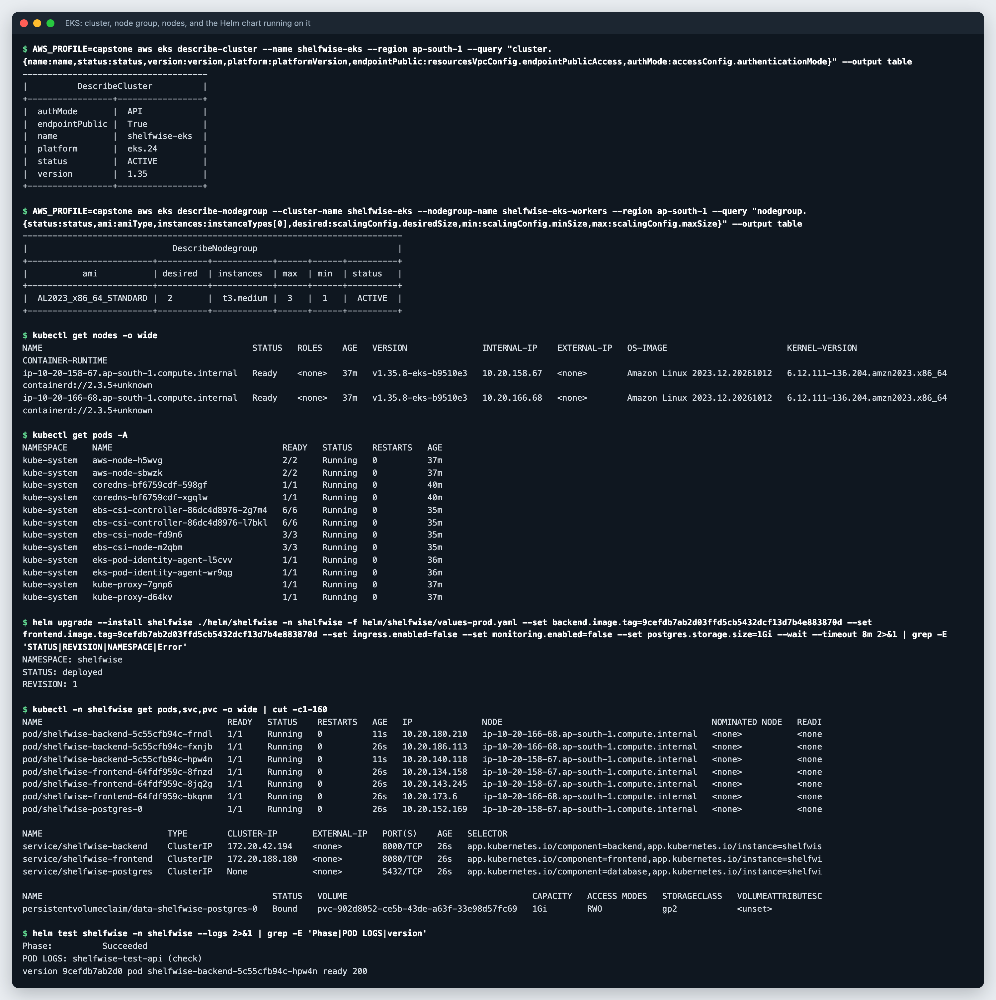 |
| **`terraform destroy`** | **Nothing left behind** |
| 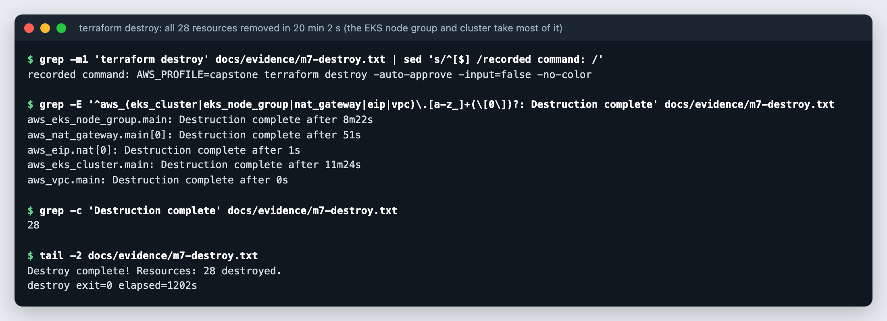 | 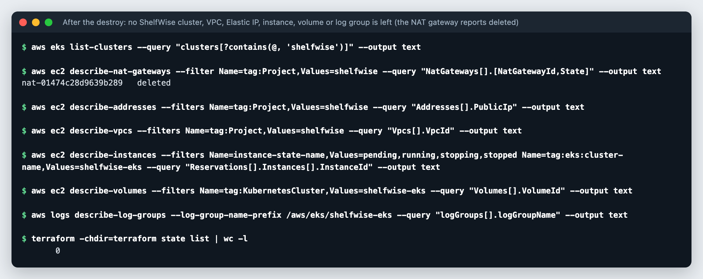 |

Raw output: [`m7-plan.txt`](docs/evidence/m7-plan.txt) · [`m7-apply.txt`](docs/evidence/m7-apply.txt) ·
[`m7-eks.txt`](docs/evidence/m7-eks.txt) · [`m7-eks-app.txt`](docs/evidence/m7-eks-app.txt) · [`m7-eks-cleanup.txt`](docs/evidence/m7-eks-cleanup.txt) · [`m7-destroy.txt`](docs/evidence/m7-destroy.txt) · [`m7-aws-cleanup.txt`](docs/evidence/m7-aws-cleanup.txt).
The operator's IP is redacted in these files; the account ID is blurred in the console screenshots.

## M8 — Kubernetes, Helm and GitOps

The chart [`helm/shelfwise/`](helm/shelfwise/) renders, for one release:

| Object | Details |
|---|---|
| Deployments | backend (HPA 2–6, rolling with `maxUnavailable: 0`, startup/liveness `/health`, readiness `/ready`), frontend (2 replicas, `/healthz`) |
| Services | ClusterIP for the API (8000) and UI (8080); headless for PostgreSQL |
| Ingress | `ingressClassName: traefik`, host `shelfwise.local`: `/api` → backend, `/` → frontend |
| StatefulSet + PVC | PostgreSQL 17, `PGDATA` in a subdirectory, runs as UID 70 |
| HPA · PDB · NetworkPolicy | CPU 60 %, scale-down after 60 s · one pod of each tier always kept · only labelled DB clients reach port 5432 |
| CronJob | lapses uncollected holds every 30 minutes (library time zone) |
| ServiceMonitor · PrometheusRule · dashboard ConfigMap | behind `monitoring.enabled` |

Every pod runs as non-root with `seccompProfile: RuntimeDefault`, a read-only root
filesystem, no privilege escalation and all capabilities dropped — required, because
[`k8s/namespace.yaml`](k8s/namespace.yaml) enforces Pod Security `restricted`. The chart
refuses to render without a commit-SHA image tag or a database Secret, and generates
no random passwords (Argo CD renders without cluster access, so one would change on
every sync).

**Two release paths, same chart:**

- `shelfwise` — managed by **Argo CD** from Git (`values-dev.yaml` + `gitops/values-gitops.yaml`).
  Argo CD renders Helm itself, so this one does not appear in `helm list`.
- `shelfwise-staging` — installed directly with **`helm upgrade --install`** by
  [`scripts/deploy-staging.sh`](scripts/deploy-staging.sh).

| `kubectl get pods,svc,ingress,hpa,pdb` | `helm list` and the staging release |
|---|---|
| 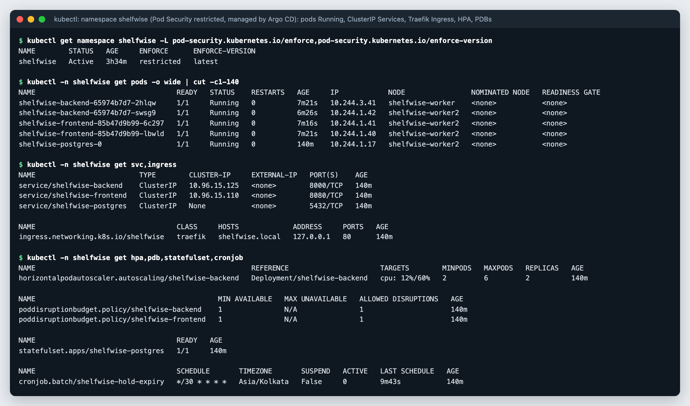 | 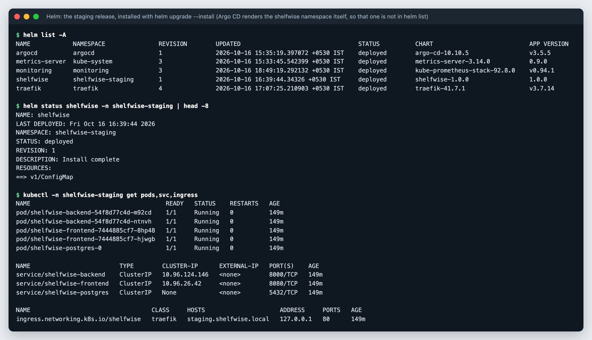 |
| **The app through the Ingress (http://shelfwise.local)** | **Argo CD: Synced and Healthy** |
| 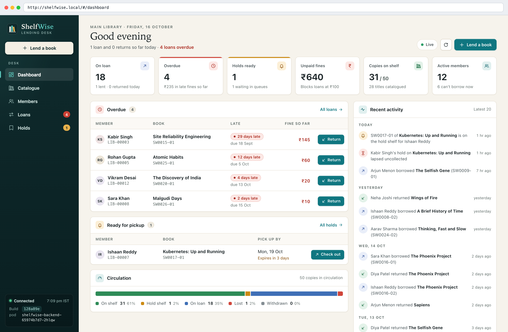 | 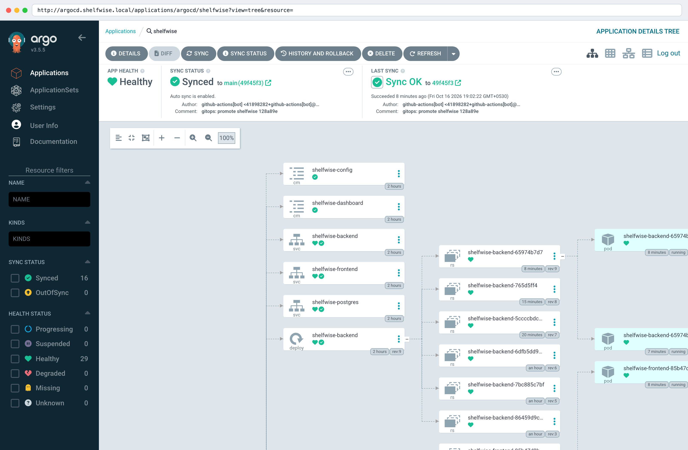 |

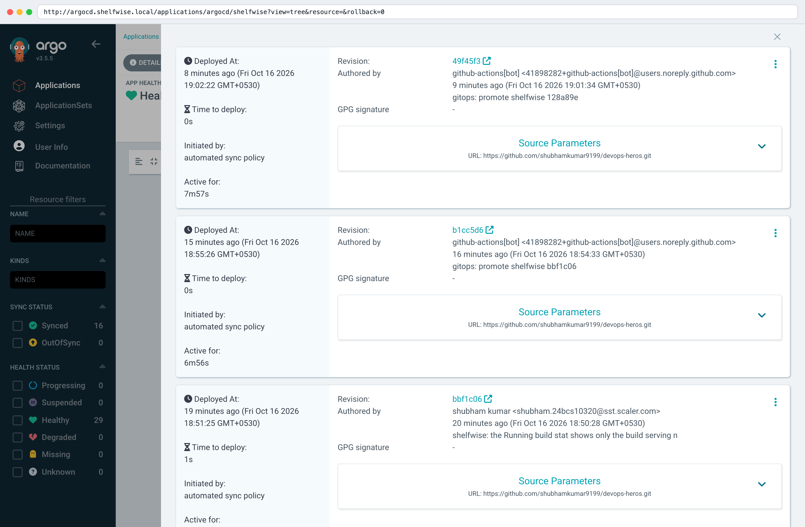

**The GitOps loop, end to end:** in the recorded demo, commit `128a89e` (a one-line change to the dashboard's date line) was committed at 18:57:57 IST and pushed. Run #10 tested, scanned, built, pushed and smoke-tested it in 3 min 35 s and committed the promotion `49f45f3` at 19:01:34. Argo CD applied that revision at 19:02:22, 48 s later and inside its 60 s polling interval, the new pods rolled out, and the sidebar at `http://shelfwise.local` switched to build `128a89e`. CI never ran `kubectl` against this cluster: the only thing it changed was the image tag in `gitops/values-gitops.yaml`.

## M9 — Observability

- `/metrics` ([`app/metrics.py`](backend/app/metrics.py)): HTTP request rate, latency
  histogram (buckets from 5 ms, so p95 means something) and status per route, plus
  business gauges read from the database at scrape time — loans out, overdue loans,
  holds, unpaid fines, copies by status — counters for loans, late returns and rule
  refusals, and `shelfwise_build_info` with the running SHA.
- Prometheus (kube-prometheus-stack, [`monitoring/`](monitoring/)) finds the app through the
  chart's ServiceMonitor; `serviceMonitorSelectorNilUsesHelmValues: false` is what lets it.
- Alert rules: API down, 5xx > 5 %, p95 > 500 ms, database unreadable, too many overdue loans.
- Grafana loads the chart's 14-panel dashboard through its sidecar.

| `curl /metrics` | Prometheus targets: UP |
|---|---|
| 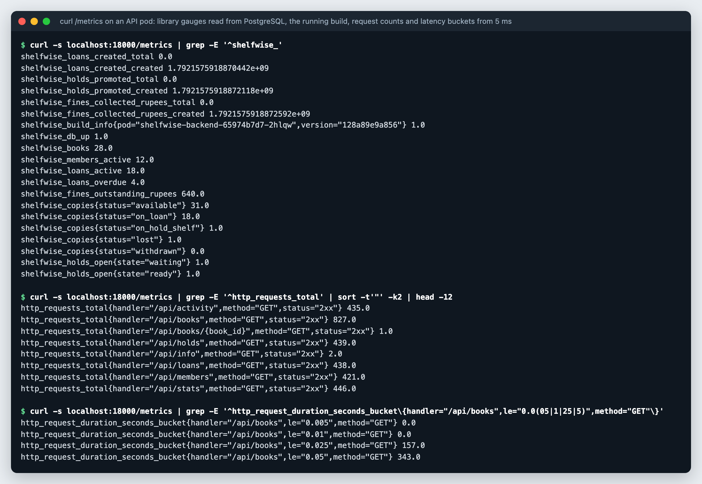 | 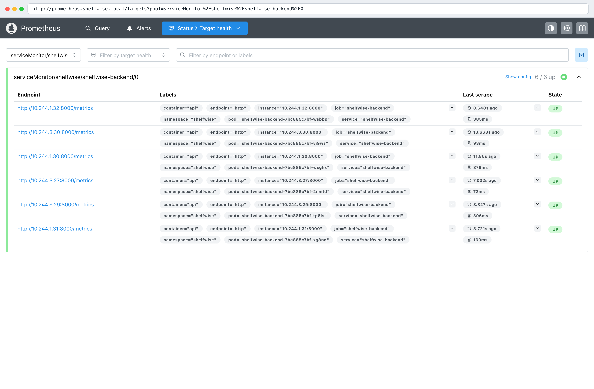 |
| **Alert rules** | **HPA under load** |
| 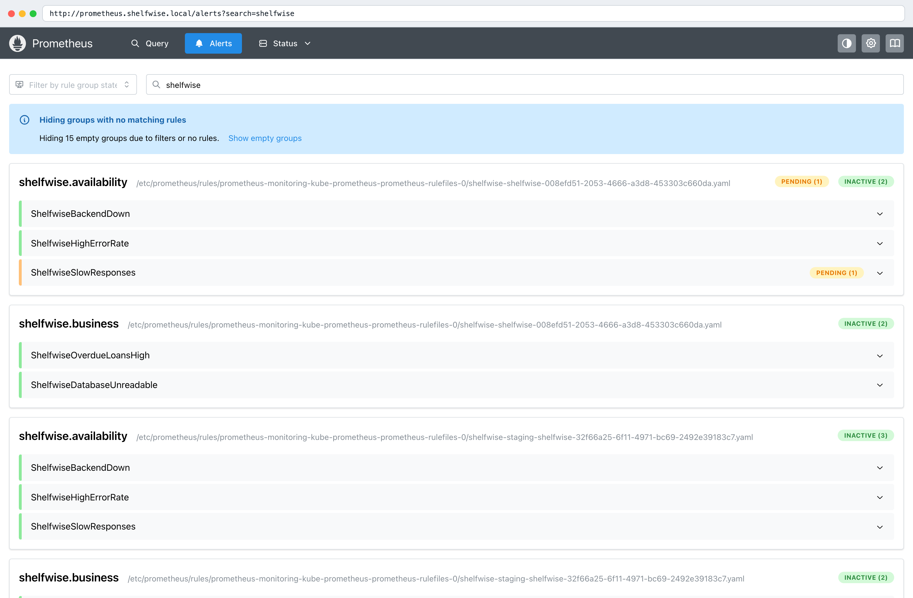 | 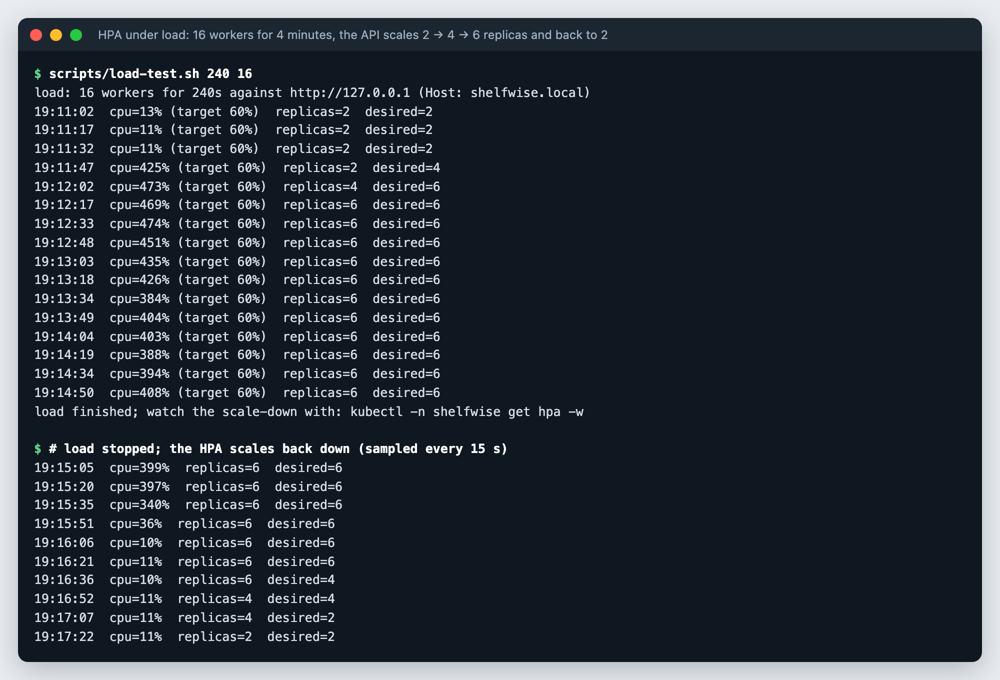 |

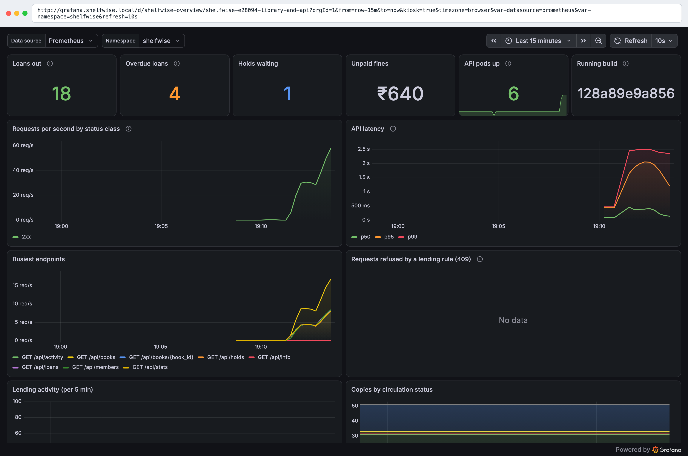

**Autoscaling, measured** ([`docs/evidence/m9-hpa-load.txt`](docs/evidence/m9-hpa-load.txt), the same run as the Grafana screenshot): 16 workers sending API requests through the Ingress for 4 minutes took the backend from 11 % to 425 % of its CPU request. The HPA asked for 4 pods at +45 s and ran its maximum of 6 from +75 s, with CPU between 384 % and 474 % until the load stopped. CPU fell below the 60 % target about 50 s after the last request; once the 60 s scale-down window had passed, the HPA stepped down 6 → 4 → 2 and was back at two pods 2 min 20 s after the load stopped.

## Troubleshooting labs

Four broken workloads in [`troubleshooting/`](troubleshooting/), each diagnosed and fixed
on the live cluster ([`docs/evidence/labs.txt`](docs/evidence/labs.txt)):

| Lab | Symptom | Cause | Fix |
|---|---|---|---|
| 1 | `ImagePullBackOff` | image tag typo (`alpne3.24`) — Events: `code = NotFound` | `kubectl set image` |
| 2 | pods Ready, Service gets `Connection refused` | selector `app=lab-wbe` matches nothing; EndpointSlice empty | `kubectl patch svc` |
| 3 | `Running` but `0/1` Ready | readiness probe on 8081, nginx listens on 8080 | patch the probe port |
| 4 | `CreateContainerConfigError` | `secret "lab-db" not found` | create the Secret; the kubelet retries by itself |

| Broken | Lab 2 diagnosed and fixed |
|---|---|
| 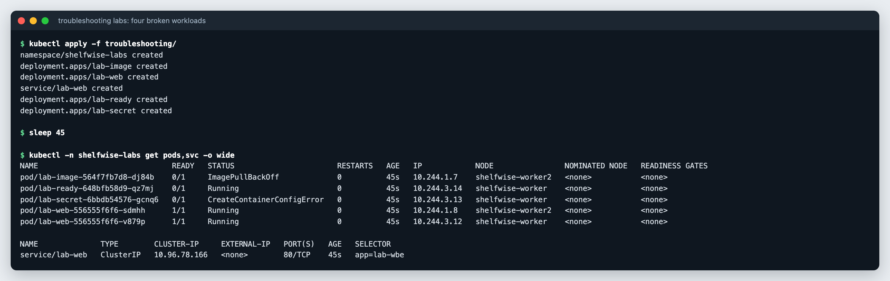 | 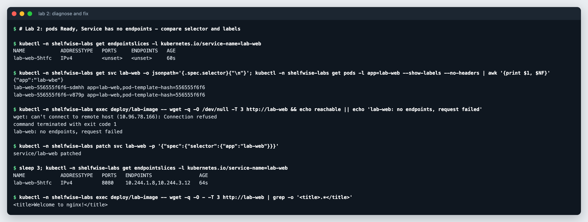 |

Details and the other three: [`troubleshooting/README.md`](troubleshooting/README.md),
[lab 1](screenshots/labs-1-fixed.png), [lab 3](screenshots/labs-3-fixed.png), [lab 4](screenshots/labs-4-fixed.png).

## Engineering findings

Real problems hit while building this, and what fixed them:

| Problem | Cause | Fix |
|---|---|---|
| Race tests passed even with the row locks deleted | Python threads are staggered by the GIL, so the first borrower committed before the others even looked | contenders run as separate **processes** (like replicas). With locks removed, one student at six desks then got 6 loans (limit 3) and the last-copy race turned into 9 generic `conflict` errors — both tests fail, so they really test the locks |
| A lost race could return 500 | `borrow()` flushes before commit; a unique-index violation surfaced there, outside the 409 handling | every flush converts `IntegrityError` to a 409, plus an app-wide handler as a safety net |
| Borrowing after a hold lapsed said "no copy on the shelf" | the session had `autoflush=False`, so the query read the copy's state before the in-memory change | autoflush back on (SQLAlchemy's default) |
| nginx in compose started but listened on nothing | `read_only` + a tmpfs on `conf.d`: the tmpfs is owned by root, so envsubst couldn't write the config and nginx ran with no server block | tmpfs mounted with `uid=101,gid=101` |
| `localhost:3000` timed out on my Mac | a VS Code extension holds `127.0.0.1:3000`, so colima couldn't forward the port | `FRONTEND_PORT` override; default stays 3000 |
| First pipeline run failed at Bandit (B608) | the seed reset used `f"DELETE FROM {table}"` | delete through SQLAlchemy table objects instead of suppressing |
| Second run failed at `helm test --logs` | `hook-succeeded` deleted the passing test pod before Helm read its logs | `before-hook-creation` only; tests off under Argo CD (it doesn't run them) |
| Traefik install rejected the values | chart 41 moved `logs.access` to `accessLog` (schema-validated) | renamed the key |
| kube-prometheus-stack install timed out | Grafana's image pull outlasted the Deployment's progress deadline on a slow link | pre-pulled the images on the kind nodes, re-ran the idempotent script |
| Trivy DB download died at 62 % | connection reset on a 128 MB download | retried from the GHCR mirror; CI caches the DB between runs |
| `starlette.testclient` import failed | Starlette 1.x moved its TestClient to `httpx2` | `httpx2` in `requirements-dev.txt` |
| Argo CD stuck at "Progressing" | Argo CD counts an Ingress healthy only once it has an address; Traefik on host ports behind a ClusterIP Service had none to publish | Traefik writes `127.0.0.1` into every Ingress status (`ingressEndpoint.ip`) |
| Upgrading Traefik hung | a surge-first rollout starts the new pod while the old one still holds host ports 80/443 | in-place rollout for host-port Deployments (`maxUnavailable: 1`, `maxSurge: 0`) |
| CI annotation: cache save failed (`tar` exit 2) | the Trivy container wrote `~/.cache/trivy` as root, so `actions/cache` couldn't read it | `chown` the cache back to the runner user after the scan |
| First AWS Console recording showed the account ID for a few seconds | the blur ran after the page rendered, and the VPC console renders inside an iframe | an init script in every frame blurs the ID from the first paint and on every DOM change |
| `ubuntu-latest` changes on 19 October 2026 | GitHub moves the label to Ubuntu 26 on the submission deadline | runners pinned to `ubuntu-24.04` |
| ingress-nginx | archived in March 2026 — no more security fixes | Traefik with standard Ingress objects |
| Grafana restarted during a load test (`OOMKilled`) | Grafana 13 idles at about 350 MiB; the 384 MiB limit left no headroom once a 30-minute dashboard was open | memory request 256 MiB, limit 1 GiB |
| The "Running build" panel listed four SHAs after a rollout | it was a range query, so every build seen in the time range stayed on the panel | an instant query: only the build serving now |

## Known issues and limitations

- **PostgreSQL runs in the cluster** (one replica, a PVC, no backups). Production would use Amazon RDS with automated backups.
- **One NAT gateway**: cheaper, but private subnets lose internet access if that AZ fails.
- **No authentication**: ShelfWise assumes a librarian-only internal network. Next step: OIDC/SSO in front of the API and UI.
- **Secrets are created with `kubectl`** by the bootstrap script (never in Git, but not GitOps-managed). Next: External Secrets with AWS Secrets Manager.
- **No TLS on the local cluster**; the prod values expect a TLS Secret (cert-manager in a real setup).
- **GitOps runs on the local kind cluster.** EKS was built with Terraform and verified, then destroyed to stop the bill; the live AWS walkthrough is in the video.
- **Unfixed base-image CVEs**: the Debian base of the backend carries 8 HIGH CVEs with no fix released yet. A scan without `--ignore-unfixed` lists them; the CI gate only blocks fixable ones (see [M6](#m6--devsecops)).
- The HPA scales on CPU only; the sidebar's pod name changes between refreshes because requests are load-balanced across replicas (by design).
- Seed data: real titles and authors, synthetic ISBNs (valid check digits), fictional members.

## M10 — Presentation

| File | What |
|---|---|
| [`demo/ShelfWise-demo.mp4`](demo/ShelfWise-demo.mp4) | 12 min captioned walkthrough (no voice-over), in the order SUBMISSION.md asks |
| [`demo/ShelfWise-presentation.pdf`](demo/ShelfWise-presentation.pdf) · [`.pptx`](demo/ShelfWise-presentation.pptx) | 15 slides: overview, tech stack, architecture, rules, testing, CI/CD, DevSecOps, Terraform, Kubernetes + GitOps, autoscaling, observability, learnings, limitations |

Video chapters: `0:00` slides · `2:56` codebase · `4:22` CI/CD: the push · `5:04` the Actions run, start and finish · `6:00` Terraform plan and the AWS Console · `9:16` Argo CD · `9:59` Kubernetes · `10:49` Prometheus · `11:23` Grafana during a load test

Live demo script (what the video shows): change the dashboard's date line →
`git commit` → `git push` → the Actions run (gates → build + Trivy → GHCR → kind smoke
test → promote) → Argo CD syncs the promotion commit → `kubectl get pods` shows the new
ReplicaSet → the app at `http://shelfwise.local` shows the new build SHA → Prometheus
targets UP → Grafana during a load test.

## Submission checklist

| Rubric item | Evidence |
|---|---|
| FastAPI `/health`, ≥ 4 REST endpoints, PostgreSQL + Alembic, React UI, responsive | [M1](#m1--application) |
| `pytest` passes, ≥ 5 tests on ≥ 3 endpoints, test DB, `pytest.ini`/`conftest.py` | [M2](#m2--testing) |
| Public repo, meaningful commits, `.gitignore` | [M3](#m3--git-and-github) |
| Backend Dockerfile, multi-stage frontend, non-root, compose starts all three | [M4](#m4--docker) |
| Workflow on push to `main`, pytest gate, frontend build, both images, GHCR, SHA tags | [M5](#m5--cicd) |
| Trivy on both images, fails on HIGH/CRITICAL, a CVE explained | [M6](#m6--devsecops) |
| Valid HCL, init, plan, VPC with 2 public subnets, EKS + node group, destroy, tfvars example | [M7](#m7--terraform-on-aws) |
| `k8s/namespace.yaml`, Helm chart, `helm upgrade --install`, 2+ replicas, ClusterIP, Ingress, pods Running | [M8](#m8--kubernetes-helm-and-gitops) |
| `/metrics`, Prometheus scraping, Grafana, a live panel | [M9](#m9--observability) |
| README, video (MP4) and slides in `demo/` | [M10](#m10--presentation) |

Cleanup: `scripts/cluster-down.sh` (kind), `docker compose down -v`, `terraform destroy`
(already done — see M7).

---

The earlier Session 21 homework (the StudySprint adaptation of the course's TaskBoard
reference app) is kept in [`task/`](task/README.md) and [`taskboard/`](taskboard/); it is
not part of this capstone.
